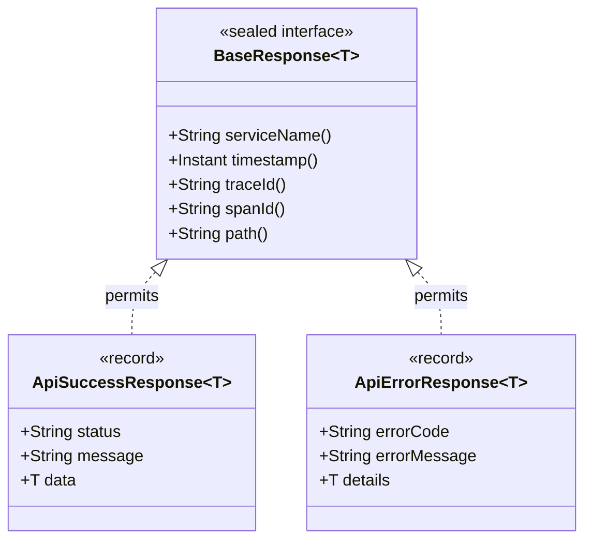

# Standardized API Response Envelopes & ResponseFactory

`blackshirt-common-spring` enforces a unified, sealed API response envelope across all microservices in the Blackshirt ecosystem. This eliminates inconsistencies across services, ensures machine-parseable contract adherence, and guarantees tracing and origin metadata are attached to every single HTTP response.

---

## Architecture Overview

All HTTP endpoints return responses encapsulated in a Java 21 sealed record hierarchy:



### Key Design Principles

1. **Type Safety & Sealed Contracts**: The sealed interface `BaseResponse<T>` permits strictly `ApiSuccessResponse<T>` and `ApiErrorResponse<T>`, allowing exhaustive pattern matching in Java 21 switch expressions.
2. **Zero Inconsistency**: Every response (whether a 200 OK or a 500 Internal Error) contains the standard metadata coordinates: `serviceName`, `timestamp`, `traceId`, `spanId`, and `path`.
3. **Automated Infrastructure Resolution**: Developers inject `ResponseFactory` instead of manually extracting request paths, looking up active distributed trace spans, or reading configuration properties.

---

## The Response Models

### 1. `ApiSuccessResponse<T>`

Represents a successful operation (`2xx` status codes).

```java
package in.blackshirt.common.response;

import java.time.Instant;

public record ApiSuccessResponse<T>(
        String serviceName,
        String status,
        String message,
        T data,
        Instant timestamp,
        String traceId,
        String spanId,
        String path
) implements BaseResponse<T> { ... }
```

#### JSON Representation:
```json
{
  "serviceName": "order-service",
  "status": "SUCCESS",
  "message": "Order created successfully",
  "data": {
    "orderId": "ORD-94812",
    "amount": 1499.00,
    "status": "CONFIRMED"
  },
  "timestamp": "2026-11-06T10:15:30.123Z",
  "traceId": "4bf92f3577b34da6a3ce929d0e0e4736",
  "spanId": "00f067aa0ba902b7",
  "path": "/api/v1/orders"
}
```

### 2. `ApiErrorResponse<T>`

Represents a failed operation (`4xx` or `5xx` status codes). Usually generated automatically by the centralized exception handlers, but can also be manually constructed via `ResponseFactory`.

```java
package in.blackshirt.common.response;

import java.time.Instant;

public record ApiErrorResponse<T>(
        String serviceName,
        String errorCode,
        String errorMessage,
        T details,
        Instant timestamp,
        String traceId,
        String spanId,
        String path
) implements BaseResponse<T> { ... }
```

#### JSON Representation:
```json
{
  "serviceName": "order-service",
  "errorCode": "ORD_001",
  "errorMessage": "Insufficient inventory stock for requested items",
  "details": {
    "sku": "BLK-TEE-L",
    "requested": 5,
    "available": 2
  },
  "timestamp": "2026-11-06T10:15:30.456Z",
  "traceId": "4bf92f3577b34da6a3ce929d0e0e4736",
  "spanId": "00f067aa0ba902b7",
  "path": "/api/v1/orders"
}
```

---

## Working with `ResponseFactory`

`ResponseFactory` is an auto-configured Spring bean that streamlines constructing `ResponseEntity<ApiSuccessResponse<T>>`. It automatically retrieves the current HTTP request URI and extracts active trace identifiers (`traceId`, `spanId`) from the distributed tracer.

### Injected Controller Example

```java
package in.blackshirt.order.controller;

import in.blackshirt.common.response.ApiSuccessResponse;
import in.blackshirt.common.response.ResponseFactory;
import in.blackshirt.order.dto.CreateOrderRequest;
import in.blackshirt.order.dto.OrderResponse;
import in.blackshirt.order.service.OrderService;
import jakarta.validation.Valid;
import org.springframework.http.ResponseEntity;
import org.springframework.web.bind.annotation.*;

import java.net.URI;
import java.util.List;

@RestController
@RequestMapping("/api/v1/orders")
public class OrderController {

    private final OrderService orderService;
    private final ResponseFactory responseFactory;

    public OrderController(OrderService orderService, ResponseFactory responseFactory) {
        this.orderService = orderService;
        this.responseFactory = responseFactory;
    }

    /**
     * Standard 200 OK with Data
     */
    @GetMapping("/{orderId}")
    public ResponseEntity<ApiSuccessResponse<OrderResponse>> getOrder(@PathVariable String orderId) {
        OrderResponse order = orderService.findById(orderId);
        return responseFactory.success(order, "Order retrieved successfully");
    }

    /**
     * Standard 200 OK without custom message
     */
    @GetMapping
    public ResponseEntity<ApiSuccessResponse<List<OrderResponse>>> listOrders() {
        List<OrderResponse> orders = orderService.findAll();
        return responseFactory.success(orders);
    }

    /**
     * Standard 201 Created with Location header
     */
    @PostMapping
    public ResponseEntity<ApiSuccessResponse<OrderResponse>> createOrder(
            @Valid @RequestBody CreateOrderRequest request) {
        OrderResponse created = orderService.create(request);
        URI location = URI.create("/api/v1/orders/" + created.orderId());
        return responseFactory.created(created, location);
    }

    /**
     * Standard 204 No Content for idempotent deletions
     */
    @DeleteMapping("/{orderId}")
    public ResponseEntity<ApiSuccessResponse<Void>> cancelOrder(@PathVariable String orderId) {
        orderService.cancel(orderId);
        return responseFactory.noContent();
    }
}
```

---

## `ResponseFactory` Method Reference

| Method | HTTP Status | Return Type | Description |
| :--- | :--- | :--- | :--- |
| `success(T data)` | `200 OK` | `ResponseEntity<ApiSuccessResponse<T>>` | Standard success response with default message (`"SUCCESS"`). |
| `success(T data, String message)` | `200 OK` | `ResponseEntity<ApiSuccessResponse<T>>` | Success response with custom domain message. |
| `created(T data, URI location)` | `201 Created` | `ResponseEntity<ApiSuccessResponse<T>>` | Sets the `Location` header and wraps body in success envelope. |
| `created(T data, String locationUri)` | `201 Created` | `ResponseEntity<ApiSuccessResponse<T>>` | Sets `Location` header from string URI and wraps body. |
| `noContent()` | `204 No Content` | `ResponseEntity<ApiSuccessResponse<Void>>` | Empty body response for deletions or updates without response body. |
| `error(ErrorCode, String, T, HttpStatus)` | Custom Status | `ResponseEntity<ApiErrorResponse<T>>` | Constructs an error response envelope with custom details and status. |

---

## Inter-Service Deserialization (Consumer Microservice)

When one microservice calls another over HTTP (e.g. via `RestClient`), deserialize using Jackson's `ParameterizedTypeReference`:

```java
@Service
public class OrderServiceClient {

    private final RestClient restClient;

    public OrderServiceClient(RestClient.Builder builder) {
        this.restClient = builder.baseUrl("https://orders.internal.blackshirt.in").build();
    }

    public OrderResponse fetchOrder(String orderId) {
        ApiSuccessResponse<OrderResponse> envelope = restClient.get()
                .uri("/api/v1/orders/{orderId}", orderId)
                .retrieve()
                .body(new ParameterizedTypeReference<ApiSuccessResponse<OrderResponse>>() {});

        if (envelope == null || envelope.data() == null) {
            throw new IllegalStateException("Empty order response received from Order Service");
        }
        return envelope.data();
    }
}
```

---

## Testing Controllers Returning Envelopes

Using Spring's `MockMvc`:

```java
@WebMvcTest(OrderController.class)
@Import({BlackshirtAutoConfiguration.class})
class OrderControllerTest {

    @Autowired
    private MockMvc mockMvc;

    @MockBean
    private OrderService orderService;

    @Test
    void shouldReturnEnvelopedSuccess() throws Exception {
        OrderResponse mockOrder = new OrderResponse("ORD-1", 500.0);
        Mockito.when(orderService.findById("ORD-1")).thenReturn(mockOrder);

        mockMvc.perform(get("/api/v1/orders/ORD-1")
                        .accept(MediaType.APPLICATION_JSON))
                .andExpect(status().isOk())
                .andExpect(jsonPath("$.status").value("SUCCESS"))
                .andExpect(jsonPath("$.message").value("Order retrieved successfully"))
                .andExpect(jsonPath("$.data.orderId").value("ORD-1"))
                .andExpect(jsonPath("$.data.amount").value(500.0))
                .andExpect(jsonPath("$.timestamp").isNotEmpty())
                .andExpect(jsonPath("$.path").value("/api/v1/orders/ORD-1"));
    }
}
```

