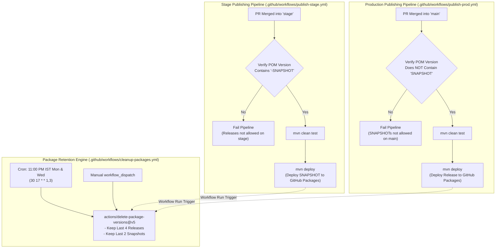

# CI/CD Pipelines & GitHub Packages Publishing

`blackshirt-common-spring` utilizes GitHub Actions to manage continuous integration, automated testing, dual-environment publishing (Stage SNAPSHOT vs Production Release), and automated package version retention.

---

## Architecture & Workflow Strategy



---

## 1. Stage Publishing Workflow (`publish-stage.yml`)

- **File**: [`.github/workflows/publish-stage.yml`](file:///e:/PROJECTS/blackshirt-common-spring/.github/workflows/publish-stage.yml)
- **Trigger**: Pull Request closed and merged into the `stage` branch.
- **Rules**:
  1. **SNAPSHOT Guard**: Extracts project version from `pom.xml`. If the version string does **not** contain `SNAPSHOT`, the workflow immediately fails with an explicit error:
     `ERROR: Stage branch requires a -SNAPSHOT version in pom.xml, but found: <version>`
  2. **Unit Tests**: Executes `mvn clean test` on Java 21 to verify all unit and integration tests pass.
  3. **Package Publishing**: Runs `mvn deploy -DskipTests` targeting the GitHub Packages repository (`https://maven.pkg.github.com/blackshirt-in/blackshirt-common-spring`).

---

## 2. Production Publishing Workflow (`publish-prod.yml`)

- **File**: [`.github/workflows/publish-prod.yml`](file:///e:/PROJECTS/blackshirt-common-spring/.github/workflows/publish-prod.yml)
- **Trigger**: Pull Request closed and merged into the `main` branch.
- **Rules**:
  1. **Release Guard**: Extracts project version from `pom.xml`. If the version string contains `SNAPSHOT`, the workflow immediately fails with an explicit error:
     `ERROR: Main branch must NOT contain -SNAPSHOT in pom.xml, but found: <version>`
  2. **Unit Tests**: Executes `mvn clean test` to guarantee test coverage on `main`.
  3. **Package Publishing**: Runs `mvn deploy -DskipTests` to publish the immutable release version (e.g. `0.1.4`) to GitHub Packages.

---

## 3. Package Retention Cleanup Workflow (`cleanup-packages.yml`)

- **File**: [`.github/workflows/cleanup-packages.yml`](file:///e:/PROJECTS/blackshirt-common-spring/.github/workflows/cleanup-packages.yml)
- **Action Used**: Official GitHub [`actions/delete-package-versions@v5`](https://github.com/actions/delete-package-versions)
- **Triggers**:
  - **Scheduled Cron**: Every Monday and Wednesday at 11:00 PM IST (`30 17 * * 1,3` UTC).
  - **Chained Workflow Trigger**: Automatically runs after every successful run of `publish-prod.yml` or `publish-stage.yml`.
  - **Manual Trigger**: `workflow_dispatch` button in the GitHub Actions UI.
- **Retention Rules**:
  - **Production Releases**: Keeps the **last 4** production releases (`min-versions-to-keep: 4`, deletes older release versions).
  - **Snapshot Releases**: Keeps the **last 2** pre-release snapshots (`min-versions-to-keep: 2`, `delete-only-pre-release-versions: 'true'`).

---

## Maven Distribution Management (`pom.xml`)

Both workflows utilize the `<distributionManagement>` block in `pom.xml`:

```xml
<distributionManagement>
    <repository>
        <id>github</id>
        <name>GitHub Packages</name>
        <url>https://maven.pkg.github.com/blackshirt-in/blackshirt-common-spring</url>
    </repository>
    <snapshotRepository>
        <id>github</id>
        <name>GitHub Packages</name>
        <url>https://maven.pkg.github.com/blackshirt-in/blackshirt-common-spring</url>
    </snapshotRepository>
</distributionManagement>
```

Credentials are automatically authenticated using GitHub Actions' built-in `${{ secrets.GITHUB_TOKEN }}`.

