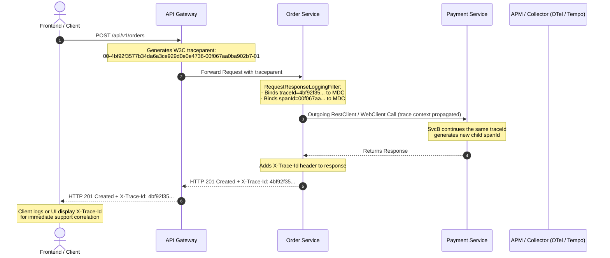

# Distributed Tracing & Correlation Standards

In distributed microservice architectures, debugging issues across dozens of distributed calls requires unified trace correlation. `blackshirt-common-spring` provides seamless integration with the W3C TraceContext standard and Spring's Micrometer Tracing ecosystem, ensuring that every log entry, response header, and error envelope carries traceable coordinates.

---

## Distributed Tracing Model



---

## Core Components

### 1. `TraceContext`

[`TraceContext`](file:///e:/PROJECTS/blackshirt-common-spring/src/main/java/in/blackshirt/common/logging/TraceContext.java) bridges Micrometer Tracing to extract current trace identifiers:

```java
package in.blackshirt.common.logging;

import io.micrometer.tracing.Tracer;

public final class TraceContext {

    public record TraceIds(String traceId, String spanId) {}

    public static TraceIds current(Tracer tracer) {
        if (tracer == null || tracer.currentSpan() == null) {
            return new TraceIds(null, null);
        }
        var context = tracer.currentSpan().context();
        return new TraceIds(context.traceId(), context.spanId());
    }
}
```

### 2. Standardized Outgoing Response Header (`X-Trace-Id`)

Every HTTP response processed by `blackshirt-common-spring` includes the `X-Trace-Id` header:

```http
HTTP/1.1 200 OK
Content-Type: application/json
X-Trace-Id: 4bf92f3577b34da6a3ce929d0e0e4736
```

If a client encounters an error or timeout, the user or frontend can quote this `X-Trace-Id` to customer support or developers, allowing engineers to query distributed log aggregators (Elasticsearch, Loki, CloudWatch) and find the exact trace immediately.

### 3. W3C `traceparent` Parsing Fallback

If a microservice does not have an active Micrometer Tracing bridge on the classpath, the library's [`HttpLoggingUtils`](file:///e:/PROJECTS/blackshirt-common-spring/src/main/java/in/blackshirt/common/logging/HttpLoggingUtils.java) inspects incoming W3C `traceparent` headers automatically:

- **Format**: `version-traceId-spanId-traceFlags`
- **Example**: `00-4bf92f3577b34da6a3ce929d0e0e4736-00f067aa0ba902b7-01`
- Extracts `traceId = "4bf92f3577b34da6a3ce929d0e0e4736"`
- Extracts `spanId = "00f067aa0ba902b7"`
- Injects both directly into MDC and outgoing envelopes.

If neither Micrometer nor incoming W3C headers are present, cryptographically random hex identifiers are generated for the request lifecycle.

---

## Adding Tracing Bridges to Consumer Microservices

`blackshirt-common-spring` depends on `io.micrometer:micrometer-tracing` with `provided` scope. Consumer microservices choose their tracer implementation:

### Option A: OpenTelemetry Bridge (Industry Standard - Recommended)

```xml
<!-- In consumer microservice pom.xml -->
<dependency>
    <groupId>io.micrometer</groupId>
    <artifactId>micrometer-tracing-bridge-otel</artifactId>
</dependency>
<dependency>
    <groupId>io.opentelemetry</groupId>
    <artifactId>opentelemetry-exporter-otlp</artifactId>
</dependency>
```

### Option B: Brave Bridge (Zipkin)

```xml
<!-- In consumer microservice pom.xml -->
<dependency>
    <groupId>io.micrometer</groupId>
    <artifactId>micrometer-tracing-bridge-brave</artifactId>
</dependency>
<dependency>
    <groupId>io.zipkin.reporter2</groupId>
    <artifactId>zipkin-reporter-brave</artifactId>
</dependency>
```

---

## Log Output with MDC Trace Correlation

When using the standard Spring Boot console pattern, all log statements executed during the request output the trace and span IDs:

```text
2026-11-06 10:25:01.100 [main] [4bf92f3577b34da6a3ce929d0e0e4736,00f067aa0ba902b7] INFO  OrderController - Fetching order ORD-1
2026-11-06 10:25:01.105 [main] [4bf92f3577b34da6a3ce929d0e0e4736,00f067aa0ba902b7] INFO  OrderRepository - Executing SQL select for order ORD-1
2026-11-06 10:25:01.115 [main] [4bf92f3577b34da6a3ce929d0e0e4736,00f067aa0ba902b7] INFO  PaymentClient   - Calling payment service for capture
```

