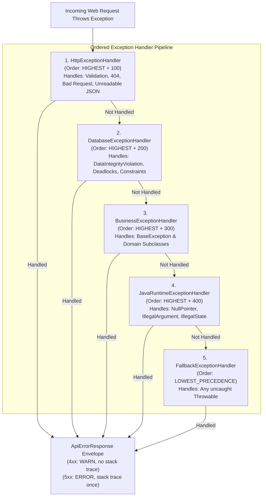

# Centralized & Tiered Exception Handling Architecture

`blackshirt-common-spring` provides a robust, multi-tiered exception handling architecture built on Spring Boot's `@RestControllerAdvice`. It eliminates verbose stack traces on client errors (4xx), guarantees single-point stack trace logging on server errors (5xx), and converts all exceptions into standard `ApiErrorResponse<T>` envelopes.

---

## Architectural Hierarchy

Rather than a monolithic error handler, the library partitions exception handling into **5 ordered tiers** extending [`AbstractExceptionHandler`](file:///e:/PROJECTS/blackshirt-common-spring/src/main/java/in/blackshirt/common/exception/handler/AbstractExceptionHandler.java):



### Handler Execution Order

The order constants are defined in [`ExceptionHandlerOrder`](file:///e:/PROJECTS/blackshirt-common-spring/src/main/java/in/blackshirt/common/exception/handler/ExceptionHandlerOrder.java):

| Handler | Order Value | Caught Exceptions | HTTP Status |
| :--- | :--- | :--- | :--- |
| **`HttpExceptionHandler`** | `Ordered.HIGHEST_PRECEDENCE + 100` | `MethodArgumentNotValidException`, `ConstraintViolationException`, `MissingServletRequestParameterException`, `HttpMessageNotReadableException`, `NoResourceFoundException`, `HttpRequestMethodNotSupportedException` | `400`, `404`, `405`, `415` |
| **`DatabaseExceptionHandler`** | `Ordered.HIGHEST_PRECEDENCE + 200` | `DataIntegrityViolationException`, `CannotAcquireLockException`, `QueryTimeoutException`, `DataAccessException` | `409 Conflict`, `500 Internal Server Error` |
| **`BusinessExceptionHandler`** | `Ordered.HIGHEST_PRECEDENCE + 300` | `BaseException` and all service-specific domain exceptions extending it | Dynamic from `ErrorCode.getHttpStatus()` |
| **`JavaRuntimeExceptionHandler`** | `Ordered.HIGHEST_PRECEDENCE + 400` | `NullPointerException`, `IllegalArgumentException`, `IllegalStateException` | `500` / `400` |
| **`FallbackExceptionHandler`** | `Ordered.LOWEST_PRECEDENCE` | `Throwable`, `Exception` (catch-all) | `500 Internal Server Error` |

---

## The `ErrorCode` Contract

Every error generated across Blackshirt services is uniquely identified by an implementation of [`ErrorCode`](file:///e:/PROJECTS/blackshirt-common-spring/src/main/java/in/blackshirt/common/exception/code/ErrorCode.java):

```java
package in.blackshirt.common.exception.code;

public interface ErrorCode {
    String getCode();
    String getDefaultMessage();
    int getHttpStatus();
}
```

### Platform Naming Convention

> [!IMPORTANT]
> All custom error codes must adhere to the format:
> `{SERVICE_PREFIX}_{NNN}`
>
> Examples:
> - `ORD_001`: Order Service - Insufficient Stock
> - `ORD_002`: Order Service - Order Not Found
> - `PAY_101`: Payment Service - Gateway Timeout
> - `USR_005`: User Service - Email Already Exists

### Built-in Framework Error Codes

The library provides standardized error codes out-of-the-box:

- **`HttpErrorCode`**: Standard HTTP validation errors (`ERR-HTTP-001` Bad Request, `ERR-HTTP-004` Forbidden, `ERR-HTTP-005` Not Found, `ERR-HTTP-008` Validation Failed).
- **`DatabaseErrorCode`**: Database failure codes (`ERR-DB-001` Data Integrity Violation, `ERR-DB-002` Duplicate Key, `ERR-DB-003` Deadlock / Concurrency Failure).
- **`RuntimeErrorCode`**: Common JVM runtime exceptions (`ERR-RT-001` Null Pointer, `ERR-RT-002` Illegal Argument).
- **`SystemErrorCode`**: General server failures (`ERR-SYS-001` Internal Server Error).

---

## Defining Domain Error Codes and Exceptions

### Step 1: Create a Domain Enum implementing `ErrorCode`

```java
package in.blackshirt.order.exception;

import in.blackshirt.common.exception.code.ErrorCode;

public enum OrderErrorCode implements ErrorCode {

    ORDER_NOT_FOUND("ORD_001", "Order was not found for the given identifier", 404),
    INSUFFICIENT_STOCK("ORD_002", "Inventory stock is insufficient for one or more items", 400),
    PAYMENT_CAPTURE_FAILED("ORD_003", "Order payment authorization or capture failed", 402),
    ORDER_ALREADY_CANCELLED("ORD_004", "Cannot modify or process an already cancelled order", 409);

    private final String code;
    private final String defaultMessage;
    private final int httpStatus;

    OrderErrorCode(String code, String defaultMessage, int httpStatus) {
        this.code = code;
        this.defaultMessage = defaultMessage;
        this.httpStatus = httpStatus;
    }

    @Override public String getCode() { return code; }
    @Override public String getDefaultMessage() { return defaultMessage; }
    @Override public int getHttpStatus() { return httpStatus; }
}
```

### Step 2: Throw `BaseException` (or a Subclass)

```java
@Service
public class OrderService {

    public OrderDto getOrder(String orderId) {
        return orderRepository.findById(orderId)
                .orElseThrow(() -> new BaseException(OrderErrorCode.ORDER_NOT_FOUND, 
                        "Order with ID " + orderId + " does not exist"));
    }

    public void validateInventory(String sku, int requestedQuantity) {
        int available = inventoryService.getStock(sku);
        if (available < requestedQuantity) {
            Map<String, Object> details = Map.of(
                    "sku", sku,
                    "requested", requestedQuantity,
                    "available", available
            );
            throw new BaseException(OrderErrorCode.INSUFFICIENT_STOCK, "Insufficient stock", details);
        }
    }
}
```

---

## Structured Diagnostic Details & `ErrorDetailKeys`

To avoid magical string keys in `details` maps, the library provides standard constant keys in [`ErrorDetailKeys`](file:///e:/PROJECTS/blackshirt-common-spring/src/main/java/in/blackshirt/common/exception/ErrorDetailKeys.java):

```java
public final class ErrorDetailKeys {
    public static final String FIELD_ERRORS = "fieldErrors";
    public static final String PARAMETER_NAME = "parameterName";
    public static final String EXPECTED_TYPE = "expectedType";
    public static final String SQL_STATE = "sqlState";
    public static final String ROOT_CAUSE = "rootCause";
    public static final String CONSTRAINT_NAME = "constraintName";
    public static final String MISSING_HEADERS = "missingHeaders";
    ...
}
```

### Validation Error JSON Example:

When a Spring `@Valid` DTO validation fails (`MethodArgumentNotValidException`), `HttpExceptionHandler` formats field errors automatically:

```json
{
  "serviceName": "order-service",
  "errorCode": "ERR-HTTP-008",
  "errorMessage": "Validation failed for request body",
  "details": {
    "fieldErrors": [
      {
        "field": "customerEmail",
        "rejectedValue": "invalid-email",
        "message": "Must be a well-formed email address"
      },
      {
        "field": "quantity",
        "rejectedValue": 0,
        "message": "Must be greater than or equal to 1"
      }
    ]
  },
  "timestamp": "2026-11-06T10:18:22.012Z",
  "traceId": "4bf92f3577b34da6a3ce929d0e0e4736",
  "spanId": "00f067aa0ba902b7",
  "path": "/api/v1/orders"
}
```

---

## Zero Log Pollution Principles

1. **4xx Client Errors**:
   - Logged at `WARN` level.
   - Outputs a concise single line:
     `WARN BusinessExceptionHandler: code=ORD_001, status=404, path=/api/v1/orders/123, message=Order not found`
   - **Stack trace is omitted**, keeping log volumes small and dashboards clean.

2. **5xx Server Errors**:
   - Logged at `ERROR` level.
   - Outputs single-line diagnostic context followed by the full stack trace **exactly once**.
   - No duplicate stack traces from catching-and-rethrowing.

3. **Client Microservice Advice**:
   - **Never** write:
     ```java
     // ❌ ANTI-PATTERN: DO NOT CATCH AND LOG BEFORE RETHROWING
     try {
         service.doWork();
     } catch (Exception e) {
         log.error("Work failed", e); // Duplicate log!
         throw e;
     }
     ```
   - Simply let the exception propagate to the tiered handlers.

