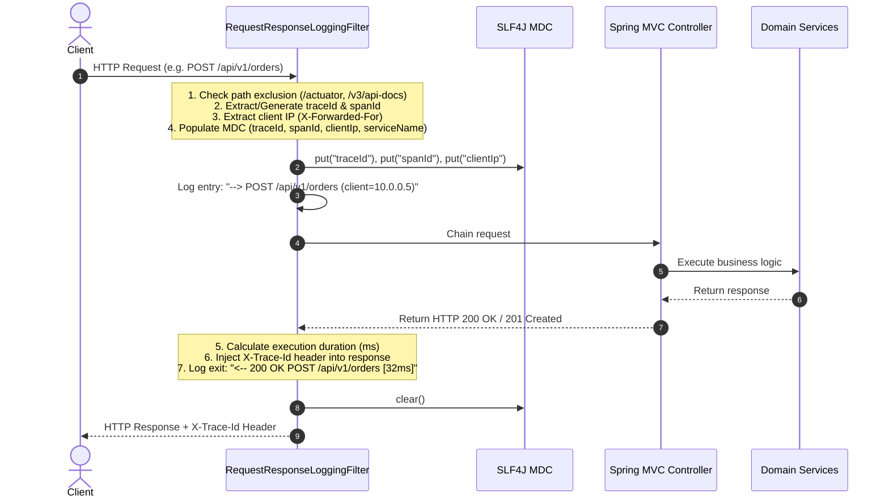

# Perimeter Request/Response Logging & Performance Tracing

`blackshirt-common-spring` implements automated boundary logging at the servlet layer via [`RequestResponseLoggingFilter`](file:///e:/PROJECTS/blackshirt-common-spring/src/main/java/in/blackshirt/common/logging/RequestResponseLoggingFilter.java). It establishes distributed tracing correlation, extracts client identifiers, logs clean entry and exit metrics, and binds diagnostic coordinates to SLF4J's `MDC`.

---

## Architecture & Lifecycle

The filter sits at the edge of the microservice servlet pipeline (`Ordered.HIGHEST_PRECEDENCE + 10`):



---

## High-Performance Utilities (`HttpLoggingUtils`)

To prevent performance degradation on high-throughput microservices, all perimeter string processing uses zero-allocation or minimal-allocation algorithms in [`HttpLoggingUtils`](file:///e:/PROJECTS/blackshirt-common-spring/src/main/java/in/blackshirt/common/logging/HttpLoggingUtils.java):

1. **Zero-Allocation Header Streaming**:
   `HttpLoggingUtils.buildHeadersString` iterates `HttpServletRequest.getHeaderNames()` directly with an `Enumeration` and appends into an initial-capacity `StringBuilder`. No intermediate `HashMap`, `ArrayList`, or iterator allocations occur. Sensitive headers (such as `Authorization` and `Cookie`) are masked inline.

2. **Index-Based IP Extraction**:
   When reading multi-hop proxy chains in `X-Forwarded-For` (`"10.0.0.1, 192.168.1.1, 172.16.0.1"`), `extractClientIp` performs an index-based search (`indexOf(',')`) to take the first IP without splitting arrays or allocating regex matchers.

3. **W3C Traceparent Parsing**:
   If no OpenTelemetry or Brave Tracer bean is active, `extractOrGenerateTraceIds` inspects the standard W3C `traceparent` header (`00-4bf92f3577b34da6a3ce929d0e0e4736-00f067aa0ba902b7-01`) directly via string slicing. If no trace header exists, high-performance random hex IDs (32-char trace ID, 16-char span ID) are generated.

---

## Log Output Formats

### 1. Default Minimal Mode (Recommended for Production)

By default, payload and header logging are disabled for maximum throughput:

```text
2026-11-06 10:20:00.100 [main] [traceId=4bf92f3577b34da6,spanId=00f067aa0ba902b7] INFO  i.b.c.l.RequestResponseLoggingFilter - --> POST /api/v1/orders (client=192.168.1.50)
2026-11-06 10:20:00.125 [main] [traceId=4bf92f3577b34da6,spanId=00f067aa0ba902b7] INFO  i.b.order.service.OrderService        - Processing order inventory for SKU=BLK-TEE
2026-11-06 10:20:00.145 [main] [traceId=4bf92f3577b34da6,spanId=00f067aa0ba902b7] INFO  i.b.c.l.RequestResponseLoggingFilter - <-- 201 Created POST /api/v1/orders [45ms]
```

### 2. Verbose Diagnostic Mode (Headers & Payload Enabled)

When `include-headers: true` and `include-payload: true`:

```text
2026-11-06 10:20:00.100 [main] [traceId=4bf92f3577b34da6,spanId=00f067aa0ba902b7] INFO  i.b.c.l.RequestResponseLoggingFilter - --> POST /api/v1/orders (client=192.168.1.50) | headers={Accept=application/json, Authorization=***, Content-Type=application/json} | body={"sku":"BLK-TEE","quantity":2,"password":"***"}
2026-11-06 10:20:00.145 [main] [traceId=4bf92f3577b34da6,spanId=00f067aa0ba902b7] INFO  i.b.c.l.RequestResponseLoggingFilter - <-- 201 Created POST /api/v1/orders [45ms] | resBody={"serviceName":"order-service","status":"SUCCESS","data":{"orderId":"ORD-1"}}
```

---

## Configuration Reference (`application.yml`)

```yaml
blackshirt:
  log:
    # Service identifier bound to MDC and response envelopes
    serviceName: order-service

  logging:
    # Master switch for the perimeter filter (default: true)
    enabled: true
    # Include incoming HTTP headers in the request log (default: false)
    include-headers: false
    # Cache and log incoming request bodies and outgoing response bodies (default: false)
    include-payload: false
    # Include query parameters in URI logging (default: true)
    include-query-params: true
    # Include matched Spring MVC path variables in response logging (default: true)
    include-path-variables: true
    # Maximum payload character count before truncating with "... [TRUNCATED]" (default: 4096)
    max-payload-length: 4096
    # Paths completely bypassed by the filter (Ant-style path patterns)
    exclude-paths:
      - /actuator/**
      - /swagger-ui/**
      - /v3/api-docs/**
      - /favicon.ico
      - /error
```

---

## Logback & Console Pattern Configuration

To expose the MDC coordinates (`traceId`, `spanId`, `clientIp`) in your application logs, configure the logging pattern in your service's `application.yml` or `logback-spring.xml`:

### Standard `application.yml` Console Pattern:

```yaml
logging:
  pattern:
    console: "%clr(%d{yyyy-MM-dd HH:mm:ss.SSS}){faint} %clr(%5p) %clr([%15.15t]){faint} %clr([%X{traceId:-},%X{spanId:-}]){cyan} %clr(%-40.40logger{39}){cyan} %clr(:){faint} %m%n"
```

### JSON / Structured Logging for Log Aggregators (ELK / Loki / Datadog):

When emitting JSON logs via Logstash encoder:
```xml
<encoder class="net.logstash.logback.encoder.LogstashEncoder">
    <includeMdcKeyName>traceId</includeMdcKeyName>
    <includeMdcKeyName>spanId</includeMdcKeyName>
    <includeMdcKeyName>clientIp</includeMdcKeyName>
    <includeMdcKeyName>serviceName</includeMdcKeyName>
</encoder>
```

---

## Anti-Duplication Logging Rules

The perimeter filter logs request arrival, HTTP parameters, duration, and completion status. Follow these strict logging rules in application code:

1. **NO Controller Entry/Exit Logging**:
   ```java
   // ❌ REDUNDANT: RequestResponseLoggingFilter already logs --> and <--
   @PostMapping
   public ResponseEntity<OrderDto> createOrder(@RequestBody OrderRequest req) {
       log.info("Entering createOrder with req: {}", req); // DO NOT DO THIS
       ...
   }
   ```

2. **NO Catch-and-Log Before Rethrowing**:
   ```java
   // ❌ REDUNDANT: Global/Tiered ExceptionHandler will log this with trace coordinates
   try {
       orderService.process(id);
   } catch (Exception ex) {
       log.error("Failed to process order", ex); // DO NOT DO THIS
       throw ex;
   }
   ```

3. **ONLY Log Business Milestones**:
   ```java
   // ✅ GOOD: Logs meaningful state transition
   log.info("Payment confirmed for orderId={}, transitioning to PACKING", orderId);
   ```

