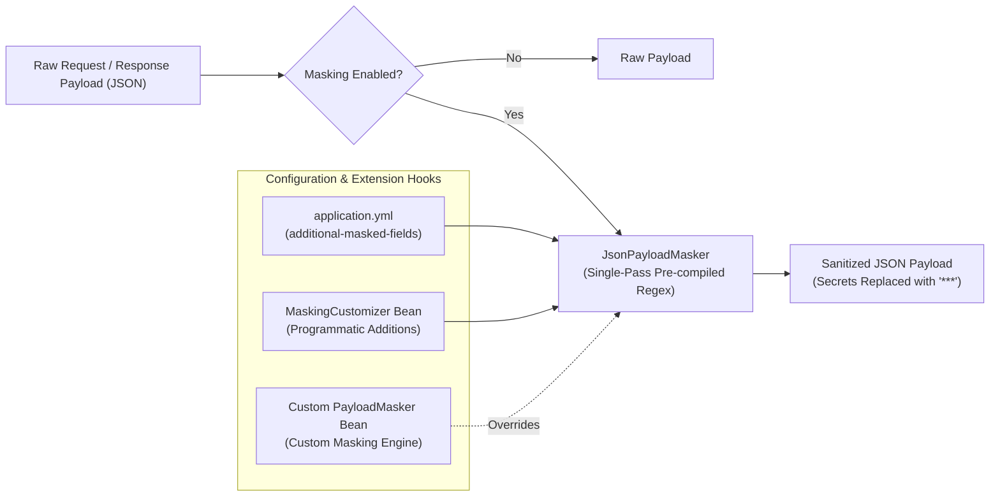

# Sensitive Data & PII Masking Engine

In a microservice ecosystem, logging credentials, payment identifiers, tokens, and PII violates compliance frameworks (PCI-DSS, GDPR, HIPAA, SOC 2). `blackshirt-common-spring` provides a high-performance, single-pass masking engine that sanitizes sensitive data from HTTP headers and JSON request/response payloads before they reach the logs.

---

## Architectural Design

The masking engine is structured around the [`PayloadMasker`](file:///e:/PROJECTS/blackshirt-common-spring/src/main/java/in/blackshirt/common/logging/PayloadMasker.java) interface and its default implementation, [`JsonPayloadMasker`](file:///e:/PROJECTS/blackshirt-common-spring/src/main/java/in/blackshirt/common/logging/JsonPayloadMasker.java):



### High-Performance Regex Alternation

Rather than parsing every JSON payload into an in-memory Abstract Syntax Tree (`JsonNode` / Jackson DOM) — which allocates significant heap objects on every HTTP request — `JsonPayloadMasker` consolidates all default and custom fields into a **single pre-compiled regular expression**:

```text
"(?i)(password|token|secret|cvv|...)"\s*:\s*("[^"]*"|\d+(?:\.\d+)?|true|false|null)
```

- Operates in a **single linear scan** across the payload string.
- Correctly matches and masks strings (`"password": "secret123"` ➔ `"password": "***"`).
- Correctly matches and masks numeric, boolean, or null values (`"cvv": 123` ➔ `"cvv": "***"`).
- Handles deeply nested JSON structures without tree recursion.

---

## Default Masked Entities

### 1. Default Masked JSON Fields
The following field names are masked automatically (case-insensitively):

- `password`
- `secret`
- `token`
- `accessToken` / `access_token`
- `refreshToken` / `refresh_token`
- `authorization`
- `apiKey`
- `cvv`
- `pin`
- `cardNumber`
- `creditCard`
- `ssn`

### 2. Default Masked HTTP Headers
The following HTTP headers are masked automatically whenever header logging is enabled:

- `Authorization`
- `Proxy-Authorization`
- `Cookie`
- `Set-Cookie`
- `X-Api-Key`
- `X-Auth-Token`

---

## Customizing Masking

### Option A: Property-Driven Customization (`application.yml`)

Microservices can add domain-specific sensitive fields and headers without writing Java code:

```yaml
blackshirt:
  logging:
    masking:
      # Master switch for masking
      enabled: true
      # Character replacement string (default: "***")
      mask-replacement: "***"
      # Append service-specific fields (preserves default fields)
      additional-masked-fields:
        - otpCode
        - bankAccountNumber
        - panNumber
        - taxId
        - nationalId
        - clientSecret
      # Append service-specific HTTP headers
      additional-masked-headers:
        - x-partner-api-key
        - x-signature-secret
```

### Option B: Programmatic Hook (`MaskingCustomizer`)

If your microservice resolves sensitive field lists dynamically from an internal config server or secret manager, register a [`MaskingCustomizer`](file:///e:/PROJECTS/blackshirt-common-spring/src/main/java/in/blackshirt/common/logging/MaskingCustomizer.java) bean:

```java
package in.blackshirt.order.config;

import in.blackshirt.common.logging.MaskingCustomizer;
import org.springframework.context.annotation.Bean;
import org.springframework.context.annotation.Configuration;

@Configuration
public class MaskingConfig {

    @Bean
    public MaskingCustomizer customMaskingRules() {
        return maskingProps -> {
            maskingProps.getAdditionalMaskedFields().add("kycDocumentNumber");
            maskingProps.getAdditionalMaskedFields().add("biometricToken");
            maskingProps.getAdditionalMaskedHeaders().add("X-Vendor-Auth");
            maskingProps.setMaskReplacement("[REDACTED]");
        };
    }
}
```

### Option C: Complete Engine Replacement (`PayloadMasker`)

For specialized compliance requirements such as **PCI-DSS Partial Masking** (e.g. keeping only the last 4 digits of a card: `****-****-****-1234`), declare a `@Bean PayloadMasker` in your microservice:

```java
package in.blackshirt.order.config;

import in.blackshirt.common.config.BlackshirtProperties;
import in.blackshirt.common.logging.PayloadMasker;
import org.springframework.context.annotation.Bean;
import org.springframework.context.annotation.Configuration;

@Configuration
public class SpecializedMaskingConfig {

    @Bean
    public PayloadMasker payloadMasker(BlackshirtProperties properties) {
        return new PciDssPartialPayloadMasker(properties.getLogging().getMasking());
    }
}
```

---

## Example Masking Transformation

### Input Request Body:
```json
{
  "orderId": "ORD-10928",
  "customer": {
    "name": "Jane Doe",
    "password": "SuperSecretPassword123!",
    "creditCard": "4111111111111234",
    "cvv": 789,
    "otpCode": 492011
  },
  "amount": 2500.00
}
```

### Output Sanitized Body in Logs:
```json
{
  "orderId": "ORD-10928",
  "customer": {
    "name": "Jane Doe",
    "password": "***",
    "creditCard": "***",
    "cvv": "***",
    "otpCode": "***"
  },
  "amount": 2500.00
}
```

