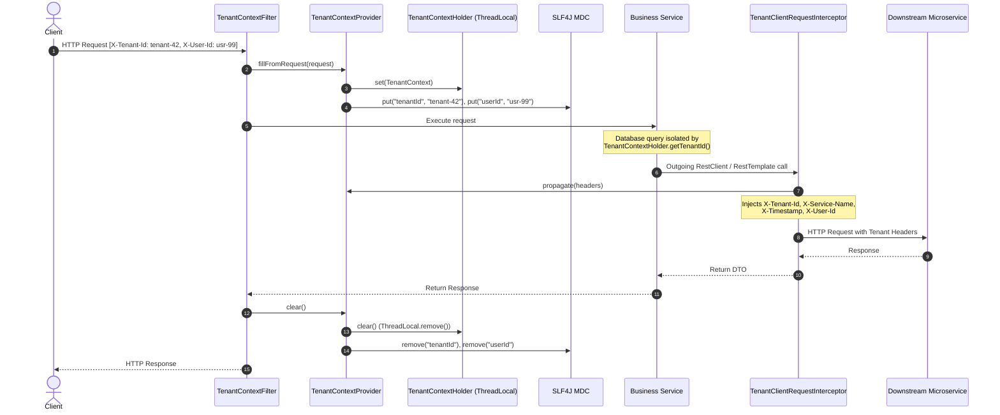

# Multi-Tenant Isolation & Context Propagation

In multi-tenant SaaS environments, ensuring total data and request isolation between tenants is critical. `blackshirt-common-spring` provides a thread-local multi-tenancy foundation that extracts tenant coordinates at the ingress servlet boundary, binds them to thread context and SLF4J MDC, and automatically propagates them downstream across microservice boundaries.

---

## Architecture Overview



---

## Core Components

### 1. `TenantContext` POJO

An immutable, serializable data container carrying the tenant's execution coordinates:

```java
package in.blackshirt.common.tenant;

public class TenantContext implements Serializable {
    private String tenantId;
    private String serviceName;
    private Instant timestamp;
    private String userId;
    ...
}
```

- **`tenantId`**: The primary tenant identifier (e.g. `"org-acme"`, `"tenant-102"`).
- **`serviceName`**: The calling service coordinate (e.g. `"order-service"`).
- **`timestamp`**: The timestamp when the context was initialized.
- **`userId`**: Optional user/caller identity associated with the tenant.

### 2. `TenantContextHolder`

Static thread-local storage utility providing zero-dependency access to the current thread's tenant context:

```java
// Access tenant anywhere in business logic
String tenantId = TenantContextHolder.getTenantId();
Optional<String> userId = TenantContextHolder.getOptionalUserId();
TenantContext context = TenantContextHolder.get();
```

### 3. `TenantContextProvider`

A managed Spring bean that handles tenant lifecycle events, MDC logging keys, and header generation for outgoing requests.

```java
@Autowired
private TenantContextProvider tenantContextProvider;

// Propagate tenant headers to Spring HttpHeaders
HttpHeaders headers = new HttpHeaders();
tenantContextProvider.propagate(headers);

// Get key-value map of headers
Map<String, String> headerMap = tenantContextProvider.getHeadersMap();
```

### 4. `TenantContextFilter`

Perimeter filter (`Ordered.HIGHEST_PRECEDENCE + 5`) that extracts tenant headers from incoming servlet requests. If `blackshirt.tenant.require-tenant-id` is enabled and the header is missing, it immediately throws [`MissingTenantException`](file:///e:/PROJECTS/blackshirt-common-spring/src/main/java/in/blackshirt/common/tenant/MissingTenantException.java), triggering an automated 400 Bad Request error response.

Guarantees thread-local cleanup in a `finally` block to prevent thread pool contamination.

### 5. `TenantClientRequestInterceptor`

An auto-configured `ClientHttpRequestInterceptor` that automatically injects tenant coordinates into outgoing HTTP calls made via `RestClient` or `RestTemplate`.

---

## Configuration Reference (`application.yml`)

```yaml
blackshirt:
  tenant:
    # Enable or disable multi-tenant context management (default: true)
    enabled: true
    # Header name for tenant identifier (default: "X-Tenant-Id")
    tenant-header-name: "X-Tenant-Id"
    # Header name for service identifier (default: "X-Service-Name")
    service-header-name: "X-Service-Name"
    # Header name for authenticated user (default: "X-User-Id")
    user-header-name: "X-User-Id"
    # Header name for request origination timestamp (default: "X-Timestamp")
    timestamp-header-name: "X-Timestamp"
    # Reject incoming requests without X-Tenant-Id with 400 Bad Request (default: false)
    require-tenant-id: true
    # Automatically bind tenant coordinates to SLF4J MDC (default: true)
    propagate-to-mdc: true
    # MDC key names:
    tenant-mdc-key: "tenantId"
    service-mdc-key: "callerService"
    user-mdc-key: "userId"
```

---

## Propagation Patterns

### 1. Inter-Service HTTP Calls via `RestClient` / `RestTemplate`

To ensure downstream microservices inherit the active tenant context, configure your `RestClient` or `RestTemplate` with [`TenantClientRequestInterceptor`](file:///e:/PROJECTS/blackshirt-common-spring/src/main/java/in/blackshirt/common/tenant/TenantClientRequestInterceptor.java):

```java
@Configuration
public class ClientConfig {

    @Bean
    public RestClient restClient(RestClient.Builder builder, TenantClientRequestInterceptor interceptor) {
        return builder
                .requestInterceptor(interceptor)
                .build();
    }
}
```

Whenever the `RestClient` executes a request, it automatically includes:
- `X-Tenant-Id: <current-tenant>`
- `X-Service-Name: <current-service>`
- `X-User-Id: <current-user>`
- `X-Timestamp: <iso-timestamp>`

### 2. Asynchronous Threads & Background Jobs

Because `TenantContextHolder` is bound to a `ThreadLocal`, child threads or `@Async` tasks do not inherit context automatically. Use a try-finally pattern with `TenantContextProvider`:

```java
@Service
public class AsyncOrderProcessor {

    private final TenantContextProvider tenantContextProvider;
    private final ExecutorService executorService;

    public AsyncOrderProcessor(TenantContextProvider tenantContextProvider, ExecutorService executorService) {
        this.tenantContextProvider = tenantContextProvider;
        this.executorService = executorService;
    }

    public void processAsync(String orderId) {
        TenantContext currentContext = tenantContextProvider.getTenantContext();

        executorService.submit(() -> {
            try {
                tenantContextProvider.fill(currentContext);
                // Business logic runs with full tenant coordinates
                orderService.process(orderId);
            } finally {
                tenantContextProvider.clear(); // CRITICAL: Always clear in child thread
            }
        });
    }
}
```

### 3. Kafka / RabbitMQ Message Consumers

When receiving messages from a message queue, extract tenant headers from the message metadata and initialize the context:

```java
@Component
public class OrderEventConsumer {

    private final TenantContextProvider tenantContextProvider;
    private final OrderFulfillmentService fulfillmentService;

    public OrderEventConsumer(TenantContextProvider tenantContextProvider, OrderFulfillmentService fulfillmentService) {
        this.tenantContextProvider = tenantContextProvider;
        this.fulfillmentService = fulfillmentService;
    }

    @KafkaListener(topics = "order-events", groupId = "fulfillment-group")
    public void onMessage(ConsumerRecord<String, OrderEvent> record,
                          @Header(value = "X-Tenant-Id", required = false) String tenantId,
                          @Header(value = "X-User-Id", required = false) String userId) {
        try {
            tenantContextProvider.fill(tenantId != null ? tenantId : "system", userId);
            fulfillmentService.fulfill(record.value());
        } finally {
            tenantContextProvider.clear();
        }
    }
}
```

